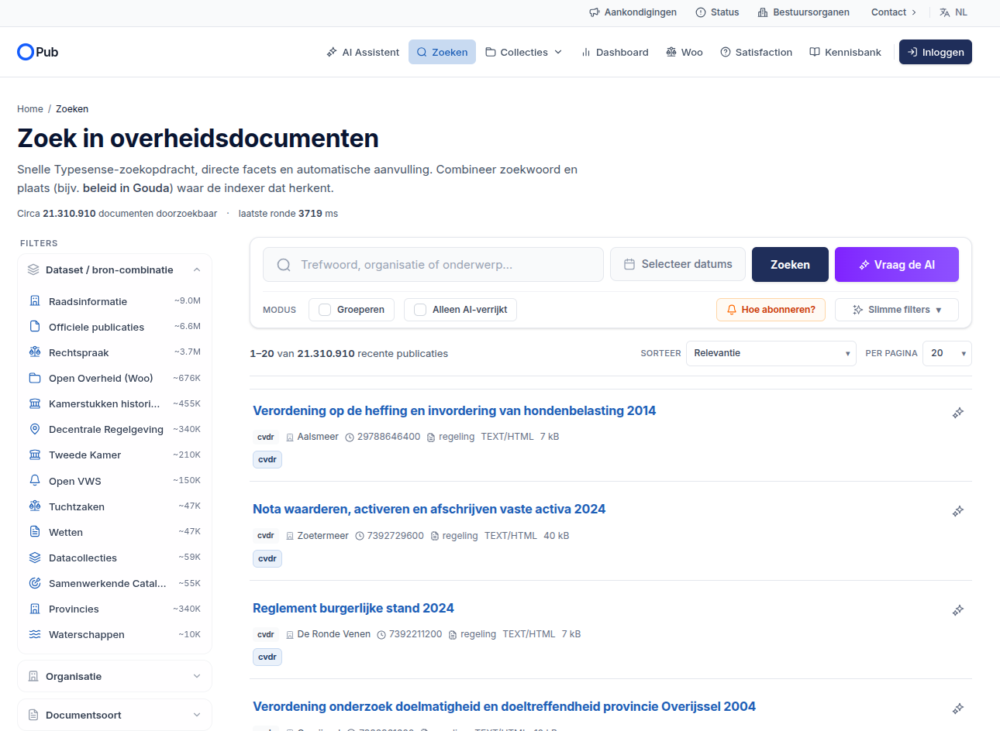
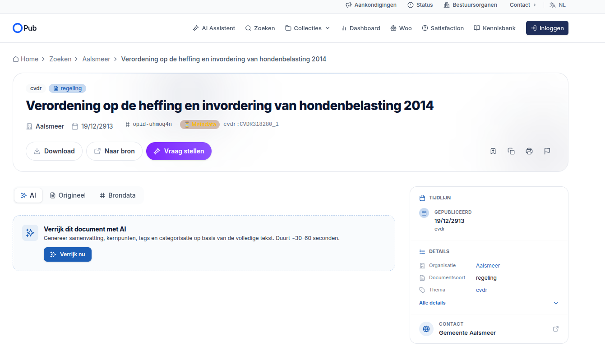

# UI inspiration — search / filter / recommend UI (reference notes)

**Status: reference material, not settled design.** Unlike the rest of the design set,
nothing here is empirically derived from the four documented projects — these are
external examples and interaction patterns to draw on when we get to the
search/filter/recommend UI (open thread: embeddings/hybrid/rerank into the UI, see
`HANDOFF.md` and the search decisions in [`README.md`](README.md)). Collected
2026-07-23.

## 1. Interaction-pattern catalog

[`../interesting-ux-concepts.md`](../interesting-ux-concepts.md) (repo root) — nine
patterns beyond the standard facet/chip vocabulary. The ones with the most obvious fit
here:

- **Query decomposition into chips** (free text / query-language live-parsed into
  editable chips — Linear, GitHub Issues) — natural front-end for our facet + BM25 +
  hybrid stack, and a natural place for LLM query understanding later.
- **Counts-driven facet disclosure** (only non-zero values, reordered as other facets
  apply) — we already compute facet counts in the OpenSearch projection; this is cheap.
- **Peek panels with URL-addressable state** — avoids modal-vs-page for document detail.
- **Saved views as forkable objects** — maps directly onto thematic scopes
  ([`thematic-scoping.md`](thematic-scoping.md)): a client slice *is* a saved view.
- **Diff/comparison overlay** — interesting once temporal source authority lands
  (versions of the same document, two crawl snapshots).

## 2. opub.nl — a clean production example (inspiration, probably improvable)

opub.nl is the same aggregator already noted in the settled decisions as a
*reference/stub source, never primary data* — but its **UI** is a good clean example of
the genre we're building. Screenshots (2026-07-23):

What it does well (worth borrowing):

- **Dataset/source-combination as the primary facet, with approximate counts**
  (Raadsinformatie ~9.0M, Officiële publicaties ~6.6M, Rechtspraak ~3.7M, Woo ~676K,
  Tuchtzaken ~47K, …) — total ~21.3M docs, Typesense-backed, with latency shown
  ("laatste ronde 3719 ms"). The per-dataset facet with counts is exactly the shape our
  multi-source projection will need.
- **Result cards carry provenance at a glance**: source badge (`cvdr`), organisation,
  ID, doc type, format + size — compact and scannable.
- **Detail page: `AI / Origineel / Brondata` tabs** — a clean separation of enriched
  view, original document, and raw source record. Maps well onto our
  distillate / blob / envelope split.
- **On-demand AI enrichment** ("Verrijk dit document met AI", ~30–60 s, generates
  summary/tags/categorisation) rather than pre-enriching everything — the same
  lazy/deferred economics as our OCR-tail and guard-conditioned LLM rescue.
- **Timeline + details sidebar** on the detail page; **"Naar bron"** always links out to
  the authoritative origin.
- Extras worth noting: alerting ("Hoe abonneren?"), a "group results" mode, an
  "AI-enriched only" filter, date-range picker next to the query box.

Where we can improve on it:

- **Data quality shows through**: the top hit's publication date renders as
  **19/12/2913** (screenshot 2) with a "Metadata" warning chip — i.e. bad source
  metadata surfaced raw to the user. Our reconciliation/validation stance (verdicts,
  typed status, vocab tables) should let us catch and label this class of error instead
  of displaying it.
- Facet counts are approximate and static; counts-driven disclosure + reordering
  (§1) would be a step up.
- No visible related-documents/recommend mode — our doc-to-doc kNN plan
  (embedding sweet spot per `../experiments/embeddings_ab/FINDINGS.md`) is a
  differentiator.
- Relevance appears BM25/Typesense-only; our settled hybrid RRF + rerank stack should
  beat it on ordering.
